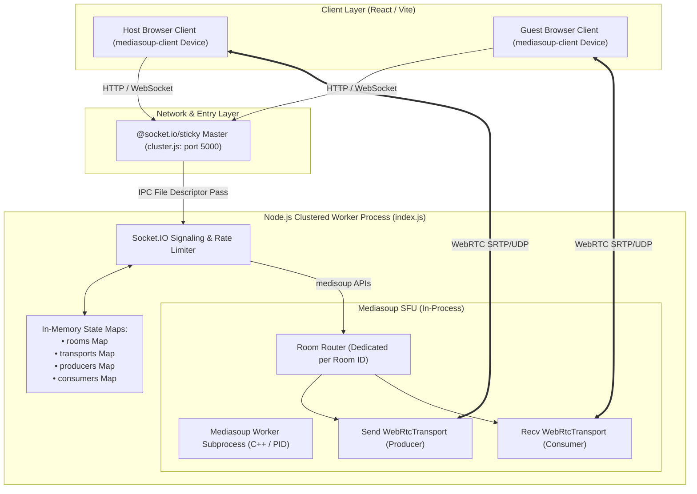

# VORTEX — Current State Architecture Audit

**Author:** Principal WebRTC Infrastructure Engineer & Distributed Systems Architect  
**Date:** November 12, 2026  
**Status:** Baseline Completed  
**Reference Codebase:** `server/index.js`, `server/cluster.js`, `client/src/hooks/useWebRTC.js`

---

## 1. Executive Summary

This audit establishes the ground truth of the VORTEX codebase prior to executing the Distributed Media Fabric architectural directive. All observations are verified directly against the running source code.

VORTEX was migrated from a peer-to-peer (P2P) mesh topology to a centralized Mediasoup Selective Forwarding Unit (SFU). While this resolved P2P client-side bandwidth explosion ($O(N^2)$ connections), the backend is currently a **monolithic single-process or uncoordinated cluster-worker model**. Room state, Mediasoup Router instances, WebRTC Transports, Producers, and Consumers reside exclusively in process memory with no cross-process synchronization or distributed media routing.

---

## 2. Current Architecture Diagram

---

## 3. Existing Media Flow

1. **Uplink (Publishing)**:
   - A participant's browser initializes a `mediasoup-client` `Device`.
   - The client calls `socket.emit('createWebRtcTransport', { direction: 'send' })`.
   - The server creates a `WebRtcTransport` on the room's `Router` with `listenIps: [{ ip: '0.0.0.0', announcedIp }]`.
   - The client negotiates DTLS through `connectWebRtcTransport`.
   - The client calls `sendTransport.produce()`:
     - **Audio Track**: Single Opus track (`opusStereo: true`, `opusDtx: true`).
     - **Video Track**: 3-layer Simulcast encodings:
       - Spatial Layer 0 (180p): `maxBitrate: 100000`, `scaleResolutionDownBy: 4.0`
       - Spatial Layer 1 (360p): `maxBitrate: 300000`, `scaleResolutionDownBy: 2.0`
       - Spatial Layer 2 (720p): `maxBitrate: 900000`, `scaleResolutionDownBy: 1.0`
     - **Screen Track**: Independent video track (`mediaType: 'screen'`).

2. **Downlink (Consuming & Webinar Policy)**:
   - When a peer produces, the server fires `new-producer`.
   - **Current Routing Rule (Webinar Mode)**:
     - If the *host* produces: `socket.to(roomId).emit('new-producer', ...)` (forwarded to all attendees).
     - If a *non-host* produces: `io.to(room.hostId).emit('new-producer', ...)` (forwarded strictly to the host).
     - Non-hosts never receive other non-hosts' media tracks.
   - The receiving client requests `socket.emit('consume', { transportId, producerId, rtpCapabilities })`.
   - The server creates a paused `Consumer` and returns RTP parameters.
   - The client creates a consumer on `recvTransport`, attaches the track to a stable `MediaStream` in `peerMediaStreamsRef`, and emits `resumeConsumer` to start media forwarding.

---

## 4. Existing Signaling Flow & Socket.IO Contract

### Client-to-Server Events:
| Event Name | Payload Contract | Description |
| :--- | :--- | :--- |
| `join-room` | `{ roomId, userName, isAudioMuted, isVideoOff, hostSecret }` | Joins room, triggers knock if admission enabled, or admits directly. |
| `admit-peer` | `{ targetPeerId }` | Host admits a waiting knock. |
| `deny-peer` | `{ targetPeerId }` | Host denies a waiting knock. |
| `admit-all-peers` | `{}` | Host admits all waiting knocks. |
| `cancel-waiting` | `{}` | Knocking user withdraws join request. |
| `update-room-settings` | `{ settings }` | Host modifies room policies (mic/camera locks, screen share, chat). |
| `host-mute-all` | `{}` | Host force-mutes all participants. |
| `host-mute-peer` | `{ targetPeerId }` | Host force-mutes a specific peer. |
| `host-kick-peer` | `{ targetPeerId }` | Host evicts a participant from the room. |
| `host-end-meeting` | `{}` | Host terminates the meeting for all peers. |
| `get-page-peers` | `{ page, pageSize }` | Requests paginated roster slice for grid rendering. |
| `getRouterRtpCapabilities`| `{}` -> cb `{ rtpCapabilities }` | Retrieves room router supported codecs. |
| `createWebRtcTransport` | `{ direction, sctpCapabilities }` -> cb `transportParams` | Creates a WebRTC send/recv transport on router. |
| `connectWebRtcTransport`| `{ transportId, dtlsParameters }` -> cb `{ connected }` | Connects WebRTC transport DTLS handshake. |
| `produce` | `{ transportId, kind, rtpParameters, appData }` -> cb `{ id }` | Publishes local track to SFU. |
| `consume` | `{ transportId, producerId, rtpCapabilities }` -> cb `consumerParams` | Subscribes to remote track on SFU. |
| `resumeConsumer` | `{ consumerId }` -> cb `{ resumed }` | Resumes media transmission for consumer. |
| `pauseProducer` | `{ producerId }` -> cb `{ paused }` | Pauses upstream producer track. |
| `resumeProducer` | `{ producerId }` -> cb `{ resumed }` | Resumes upstream producer track. |
| `closeProducer` | `{ producerId }` -> cb `{ closed }` | Closes upstream producer track. |
| `toggle-media` | `{ isAudioMuted, isVideoOff }` | Updates participant mic/camera states in roster. |
| `speaking-level` | `{ level }` | Reports client VAD level (triggers active speaker state). |
| `screen-share-status` | `{ isSharing }` | Updates screen-share state in roster. |
| `raise-hand` | `{ isHandRaised }` | Updates hand-raise state in roster. |
| `send-chat` | `{ message }` | Broadcasts sanitized chat message. |
| `disconnect` | `{}` | Peer disconnect cleanup and host failover. |

### Server-to-Client Events:
| Event Name | Payload Contract | Description |
| :--- | :--- | :--- |
| `room-snapshot` | `{ roomId, isHost, hostSecret, hostId, settings, totalParticipants, participants, waitingList, existingProducers, activeSpeakers }` | Initial synchronization payload on entry. |
| `room-deltas` | `[ { type: 'user-joined'\|'user-left'\|'peer-media-toggle'\|..., ... } ]` | Batched 50ms interval room state updates. |
| `waiting-for-admission` | `{ message }` | Indicates user is in the knocking waiting room. |
| `join-denied` | `{ message }` | Indicates host rejected entry. |
| `participant-knock` | `{ peerId, userName, requestedAt }` | Sent to host when user knocks. |
| `knock-handled` | `{ peerId, status }` | Confirms knock resolution. |
| `new-producer` | `{ producerId, producerPeerId, kind, appData }` | Notifies receiver of newly available media track. |
| `producer-closed` | `{ producerId, peerId }` | Notifies consumers that track was closed. |
| `consumer-closed` | `{ consumerId, producerId }` | Notifies client that consumer closed. |
| `host-changed` | `{ newHostId, newHostName }` | Notifies room of host migration. |
| `host-token-update` | `{ hostSecret }` | Issues cryptographic token to newly elected host. |
| `force-mute-audio` | `{}` | Instructs client to mute local microphone. |
| `force-disable-video` | `{}` | Instructs client to disable local camera. |
| `kicked-from-room` | `{ reason }` | Informs user of eviction. |
| `meeting-ended-by-host`| `{ message }` | Informs user of meeting closure. |

---

## 5. Current Room Lifecycle

1. **Initialization**:
   - `getOrCreateRoom(roomId)` is invoked upon `join-room`.
   - If not yet present in `rooms = new Map()`, an in-memory object is created.
   - A Mediasoup Router is instantiated: `await mediasoupWorker.createRouter({ mediaCodecs })`.
   - A 192-bit cryptographic host secret (`crypto.randomBytes(24).toString('hex')`) is generated.
   - The room object initializes internal maps: `participants`, `waitingParticipants`, `activeSpeakers`, `transports`, `producers`, `consumers`.

2. **Joining & Admission**:
   - The first participant is assigned `hostId = socket.id`.
   - If `room.settings.hostAdmission` is true, subsequent joining guests enter `room.waitingParticipants` and must be admitted by the host via `admit-peer`.
   - When admitted, `admitParticipantToRoom` runs, sending a filtered `room-snapshot`.

3. **Departure & Cleanup**:
   - On `socket.disconnect`:
     - Clean up socket's producers, consumers, and WebRTC transports.
     - Remove participant from `room.participants`.
     - If the departing user was the host, elect the next participant in `room.participants` as host, issue a new `hostSecret`, and transfer the waiting list.
     - If the room becomes empty (0 participants and 0 waiting), close `room.router` and delete `rooms.get(roomId)`.

---

## 6. Current Worker Lifecycle

- In `server/index.js`, a single global reference `let mediasoupWorker = null` is maintained per Node process.
- Initialized on boot via `mediasoup.createWorker({ rtcMinPort, rtcMaxPort })`.
- Handles `'died'` event by logging and calling `process.exit(1)` after 2 seconds.
- In `server/cluster.js`, the primary process uses `@socket.io/sticky` and forks up to 4 worker processes.
- **Critical Architectural Flaw**: Each clustered worker process has its own separate `mediasoupWorker` and its own separate `rooms = new Map()`. If client A connects to worker process 1 and client B connects to worker process 2 for the same `roomId`, worker 2 creates an independent `Router` that knows nothing about worker 1's `Router`. Neither client can consume the other's tracks!

---

## 7. Identified Architectural Limitations

1. **Single-Worker / Uncoordinated Multi-Worker Constraint**:
   - Mediasoup Routers cannot communicate across worker processes without explicit `PipeTransport` setup.
   - The Socket.IO cluster adapter relays socket messages, but does not coordinate Mediasoup objects or media routing.
2. **Process-Local Ephemeral State**:
   - Meeting metadata, active participants, host tokens, and knocking queues are in-memory JavaScript Maps. A worker restart destroys all active meetings.
3. **Webinar-Only Hardcoded Media Policy**:
   - Guest tracks are routed only to the host (`io.to(room.hostId)`). Regular conference/group meeting media exchange (where peers can see other active speakers) is not supported.
4. **No Dynamic Adaptive Subscription**:
   - The client hook blindly subscribes to whatever `existingProducers` or `new-producer` events it receives. There is no server-side or client-side subscription policy prioritizing active speakers, pinned peers, or network health.
5. **No Shared Session Store / No Reconnection Recovery**:
   - Disconnections result in immediate removal from the room. Reconnections only recover host status if the client retained `hostSecret`, but all media transports must be rebuilt from scratch with no session resumption protocol.
6. **No Distributed Node Health or Failure Supervision**:
   - If a Mediasoup worker crashes, the entire Node.js worker process exits, abruptly cutting off all rooms assigned to that process without failover.

---

## 8. Existing Functionality That Must NOT Break

During and after the architectural evolution, the following verified capabilities must be strictly preserved:
- VORTEX brand identity (typography, colors `#252B2D`, `#F4F3EF`, `#9EAB9D`).
- Lobby device selection and pre-call audio/video toggling.
- Live microphone volume meter (VAD via Web Audio API).
- Host admission / waiting room knocking workflow and host controls (`admit`, `deny`, `admit-all`).
- Host moderation capabilities: mute peer, mute all, kick peer, lock room, end meeting.
- Cryptographic host token preservation across host reconnections.
- In-call chat with XSS sanitization and chat permission toggles.
- Hand raising, screen sharing, and active speaker spotlight.
- Picture-in-Picture (PiP) and keyboard shortcuts (`Ctrl+D`, `Ctrl+E`, `Ctrl+H`, `Spacebar` push-to-talk).
- Non-blocking toast notifications.
- HTTP `/healthz` and `/readyz` probes.
