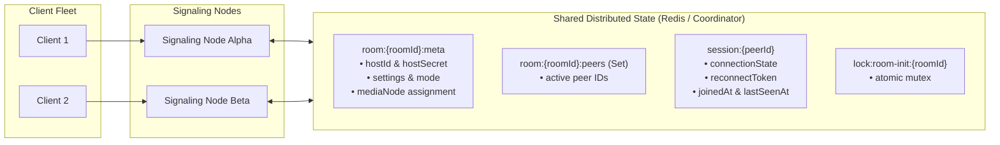

# VORTEX — Distributed State & Session Management

**Document:** `docs/architecture/distributed-state.md`  
**Status:** Production Architecture

---

## 1. Overview

VORTEX manages distributed session and room state through a two-tiered architecture:
1. **Shared Coordination Layer (Redis / Memory Atomic Coordinator)**: Ephemeral session presence, room metadata, distributed locks, and reconnection tokens.
2. **Local Media Object Layer**: Mediasoup C++ Workers, Routers, Transports, Producers, and Consumers remain strictly owned by their respective media worker processes.

---

## 2. Distributed Key Schema

| Key Pattern | Type | TTL | Purpose |
| :--- | :--- | :--- | :--- |
| `room:{roomId}:meta` | Hash / JSON | 24 Hours | Room configuration, hostId, hostSecret, settings, meeting mode |
| `room:{roomId}:peers` | Set | None | Active admitted participant peer IDs |
| `session:{peerId}` | Hash / JSON | 1 Hour | Participant session metadata, connectionState, role, reconnectToken |
| `token:{reconnectToken}` | String | 1 Hour | Reverse index mapping reconnect token to participant session |
| `lock:room-init:{roomId}` | String | 5 Seconds | Atomic mutex preventing race conditions during room router creation |

---

## 3. Distributed Room Ownership & Atomic Creation

To prevent two signaling processes from simultaneously creating conflicting routers for the same `roomId`:
1. Node calls `distributedState.acquireLock('room-init:' + roomId, 5000)`.
2. Once the lock is acquired, the node verifies if `room:{roomId}:meta` already exists.
3. If new, it assigns the room to the least-loaded worker in the local `WorkerPool`, records the assignment, and releases the lock.
4. Subsequent nodes check the registry and connect to the existing room without duplicate allocation.

---

## 4. Reconnection Protocol & 30-Second Grace Window

When a participant experiences a network interruption or socket drop:
1. `sessionManager.handleDisconnect(peerId)` marks `connectionState = 'disconnected_grace'`.
2. A 30-second grace timer is initiated.
3. If the client reconnects within 30 seconds presenting their `reconnectToken`:
   - Session metadata is validated.
   - The grace timer is immediately cancelled.
   - The participant is re-anchored to the room roster without losing host authority or triggering knock prompts.
4. If the timer expires without reconnection, stale resources and session keys are purged.
