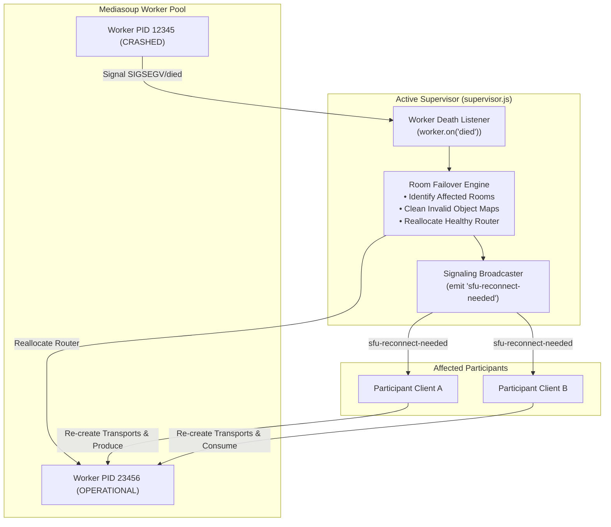

# VORTEX — Failure Recovery, Supervision & Reliability

**Document:** `docs/architecture/failure-recovery.md`  
**Status:** Production Architecture

---

## 1. Reliability Architecture

VORTEX implements active supervision across Mediasoup C++ worker subprocesses, signaling nodes, and network connections.

---

## 2. Failure Scenarios & Recovery Workflows

### Scenario 1: Mediasoup Worker Process Death
- **Detection**: `WorkerPool` binds to the C++ worker's `died` event.
- **Failover Routine**:
  1. `supervisor.handleWorkerCrash()` identifies all rooms mapped to that worker.
  2. Dead transports, producers, and consumers in affected room objects are cleared from memory.
  3. A new Mediasoup Router is immediately instantiated on a surviving worker core via `RouterAllocator`.
  4. The supervisor emits `sfu-reconnect-needed` to all connected clients in that room.
  5. The `WorkerPool` automatically respawns a replacement worker process to restore worker pool capacity.
- **Client Action**: Clients re-initialize their send/receive WebRtcTransports and republish/reconsume active tracks without refreshing the browser.

### Scenario 2: Signaling Node Interruption
- Because session metadata, host tokens, and room ownership are stored in the shared `DistributedState` layer, participants reconnecting to another signaling node recover their host privileges and room roster seamlessly.

### Scenario 3: Network Quality Degradation
- The client measures transport telemetry (RTT, packet loss, jitter) via `transport.getStats()`.
- Telemetry is mapped into quality tiers:
  - **Excellent**: Full 720p spatial layer for active speaker, 360p for grid tiles (up to 6 tiles).
  - **Fair**: Throttled to 360p high / 180p tiles (up to 4 tiles).
  - **Poor / Critical**: Throttles video to 180p, pauses non-speaker video, prioritizing crystal-clear Opus audio.

---

## 3. Observability & Probes

- **Liveness Probe (`/healthz`)**: HTTP 200 OK verifying the process event loop is responsive.
- **Readiness Probe (`/readyz`)**: Verifies that at least one Mediasoup C++ worker is alive and ready to process WebRTC media.
- **Metrics Endpoint (`/api/metrics`)**: Serves JSON system load or Prometheus-formatted metrics when requested with `Accept: text/plain`.
