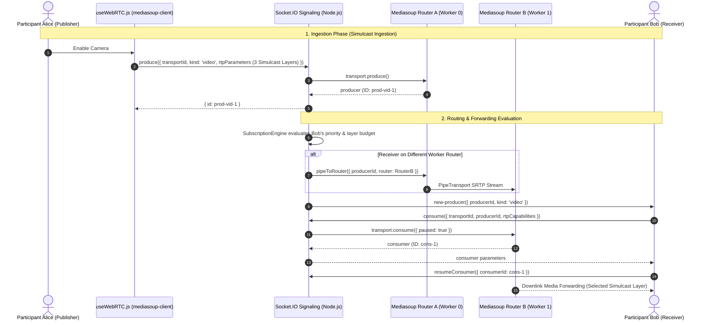

# VORTEX — Media Routing & Transport Architecture

**Document:** `docs/architecture/media-routing.md`  
**Status:** Production Architecture

---

## 1. Overview

The VORTEX Distributed Media Fabric provides flexible, low-latency WebRTC media routing using **Mediasoup C++ Workers** arranged in a multi-worker pool. It supports both **Group Conference Mode** (peer-to-peer visibility through SFU) and **Webinar Mode** (strict host-moderated broadcast).

---

## 2. Ingestion & Multi-Layer Simulcast

Local camera video streams are ingested using 3-layer spatial simulcast:

| Layer | RID | Resolution | Target Bitrate | Scale Factor | Use Case |
| :--- | :--- | :--- | :--- | :--- | :--- |
| **Layer 0 (Low)** | `r0` | 180p (320x180) | 100 kbps | 1/4 | Inactive grid tiles, constrained downlink |
| **Layer 1 (Medium)** | `r1` | 360p (640x360) | 300 kbps | 1/2 | Standard active grid tiles (2-6 tiles) |
| **Layer 2 (High)** | `r2` | 720p (1280x720) | 900 kbps | 1.0 (Full) | Active speaker spotlight & pinned participant |

Screen-sharing video tracks are produced as independent high-framerate/high-detail video producers (`mediaType: 'screen'`) without spatial downscaling.

---

## 3. Meeting Modes: Conference vs Webinar

The meeting policy engine supports two distinct routing topologies configurable by the host:

### Mode A: Group Conference (`conference`)
- All admitted participants are authorized to produce audio, video, and screen share (subject to host locks).
- The SFU broadcasts `new-producer` events to all room members.
- Participants consume each other's audio and video according to the **Intelligent Subscription Engine** budget (up to 6 concurrent video tiles).

### Mode B: Webinar Privacy (`webinar`)
- Host feeds (audio, video, screen share) are forwarded to all participants.
- Non-host participant feeds are routed strictly to the Host and Co-Hosts.
- Regular attendees do not receive other attendees' media or presence information.

---

## 4. Cross-Worker & Cross-Host PipeTransport Protocol

When room capacity exceeds a single worker core or spans multiple media nodes:
1. **Local Inter-Worker Pipe**:
   - `pipeManager.pipeProducerLocal({ sourceRouter, targetRouter, producerId })` invokes Mediasoup's C++ `pipeToRouter` API.
   - Creates a bidirectional loopback `PipeTransport` pair between the worker processes.
2. **Cross-Host Forwarding**:
   - `pipeManager.createCrossHostPipeTransport(router, { listenIp })` allocates UDP pipe ports.
   - Transports connect across hosts exchanging IP and port tuples.
   - Stream is consumed on source pipe transport and produced on target pipe transport.
