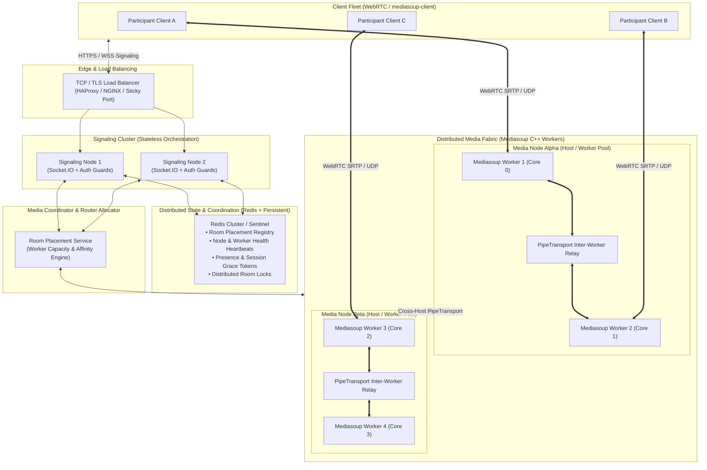

# VORTEX — Target Distributed Media Fabric Architecture

**Author:** Principal WebRTC Infrastructure Engineer & Distributed Systems Architect  
**Date:** November 12, 2026  
**Status:** Architecture Specification & Engineering Blueprint

---

## 1. System Architecture Overview

The VORTEX Distributed Media Fabric decouples signaling orchestration, media plane processing, and shared cluster state into clean, independently scalable subsystems.



---

## 2. Architectural Subsystems

### Subsystem 1: Media Node & Worker Pool Manager
- **Multi-Worker Pool**: Each Media Node hosts a pool of C++ Mediasoup Workers mapped to individual CPU cores.
- **Capacity Metric**: Tracks active routers, transports, producers, and consumers per worker.
- **Worker Allocation**: Uses a weighted least-loaded strategy for new router placement.
- **Cross-Router & Cross-Worker PipeTransports**: When participants in the same room are served by different workers (or different nodes), media tracks are forwarded via Mediasoup's `PipeTransport` protocol.

### Subsystem 2: Virtual Media Stream (VMS) Abstraction
- Provides a receiver-centric logical subscription layer inspired by large-scale conferencing systems (like Google Meet's virtual stream slots).
- Decouples raw publisher producers from receiver downstream subscriptions.
- Each receiver is allocated a configurable budget of active downstream video slots (default 6).
- The VMS dynamically binds these slots to the highest-priority publishers:
  1. Active Screen Share (always top priority)
  2. Pinned Participant
  3. Active Speaker (via vocal VAD and recent speech history)
  4. Currently Visible Viewport Tiles
- Off-screen or lower-priority streams are paused or downscaled, conserving receiver CPU and downlink bandwidth.

### Subsystem 3: Intelligent Subscription & Adaptive Simulcast Engine
- **Spatial/Temporal Layer Control**:
  - High-priority tiles (active speaker, pinned peer) receive Spatial Layer 2 (720p @ 900 kbps).
  - Standard grid tiles receive Spatial Layer 0 or 1 (180p / 360p).
  - Off-screen or thumbnail tiles receive Spatial Layer 0 or are paused.
- **Network Quality Classifier**:
  - Samples transport RTT, packet loss, and jitter.
  - Dynamically throttles preferred layers or drops video when connection quality degrades, preserving crystal-clear audio.

### Subsystem 4: Group Meeting Media Routing & Security Boundaries
- Transits from webinar-only routing (host-to-all, guest-to-host) to a full **Conference & Webinar hybrid policy**.
- Implements meeting modes:
  - `conference`: All authorized peers produce and consume media according to the subscription engine.
  - `webinar`: Non-hosts receive host streams, while non-host feeds are routed to host/co-hosts only.
- Strict multi-layered authorization:
  - Transport ownership check (`transport.appData.peerId === socket.id`).
  - Producer ownership check (`producer.appData.peerId === socket.id`).
  - Consumer authorization check (peer is in the room and permitted to consume).
  - Permission checks before publishing mic, camera, or screen share.

### Subsystem 5: Distributed Room & Session State Management
- Shared Redis-backed coordination with pluggable in-memory fallback:
  - `vortex:rooms:{roomId}:meta`: Room configuration, hostId, mode, settings.
  - `vortex:rooms:{roomId}:placement`: Media node and worker assignment.
  - `vortex:rooms:{roomId}:participants`: Set of active participant peer IDs.
  - `vortex:peers:{peerId}:session`: Participant metadata, signaling node ID, role, and reconnection token.
- **Graceful Reconnection Protocol**:
  - Disconnected participants are granted a 30-second grace period before being removed from the room roster.
  - Upon reconnection, existing session metadata is validated, and media transports are cleanly re-anchored.

### Subsystem 6: Worker Supervision, Failure Recovery & Observability
- **Worker Crash Detection**: Listens to worker `died` events.
- **Failover Routine**: Marks the worker offline, triggers room router re-instantiation on an alternate healthy worker, and notifies clients via `sfu-reconnect-needed` to recreate their WebRTC transports.
- **Prometheus-Compatible Metrics**: Exposes active rooms, participants, workers, transports, producers, consumers, and latency histograms.

---

## 3. Directory Layout for Backend Refactoring

To maintain strict modularity and eliminate the monolithic 1400-line `server/index.js`, we organize the backend into domain-driven modules:

```
server/
├── index.js                     # Unified server entry point & HTTP router
├── cluster.js                   # Sticky cluster process supervisor
├── config/
│   └── index.js                 # Environment variables & runtime constants
├── media/
│   ├── workerPool.js            # Mediasoup Worker Pool Manager
│   ├── mediaNode.js             # Media Node abstraction & capacity tracking
│   ├── routerAllocator.js       # Router allocation & room placement
│   ├── pipeManager.js           # PipeTransport inter-worker & inter-node forwarding
│   └── simulcastManager.js      # Simulcast layer selection & bandwidth adaptation
├── subscription/
│   ├── virtualMediaStream.js    # VirtualMediaStream logical abstraction
│   ├── subscriptionEngine.js    # Relevance & subscription policy engine
│   └── networkMonitor.js        # WebRTC transport stats & quality classification
├── state/
│   ├── distributedState.js      # Redis state coordinator (with in-memory fallback)
│   ├── sessionManager.js        # Participant sessions & grace period reconnection
│   └── roomManager.js           # Distributed room lifecycle management
├── security/
│   ├── authGuard.js             # Signaling payload & ownership validation
│   └── sanitizer.js             # Strict input sanitization & XSS prevention
├── monitoring/
│   ├── metrics.js               # Prometheus & system load metrics
│   └── supervisor.js            # Worker & Node health supervisor
└── signaling/
    └── socketHandlers.js        # Clean Socket.IO signaling controllers
```

---

## 4. Implementation Phasing & Safety Guarantees

Every phase introduces tested, production-grade modules while maintaining 100% backward compatibility with the existing React frontend:
1. **Phase 1**: Security, Validation, and Group Meeting Media Routing.
2. **Phase 2**: Intelligent Media Subscription & Simulcast Layer Adaptation.
3. **Phase 3**: Worker Pool, Media Node, and Cross-Router Forwarding.
4. **Phase 4**: Distributed State Coordination, Room Placement & Reconnection.
5. **Phase 5**: Virtual Media Stream Abstraction.
6. **Phase 6**: Failure Recovery Supervision, Metrics & End-to-End Testing.
