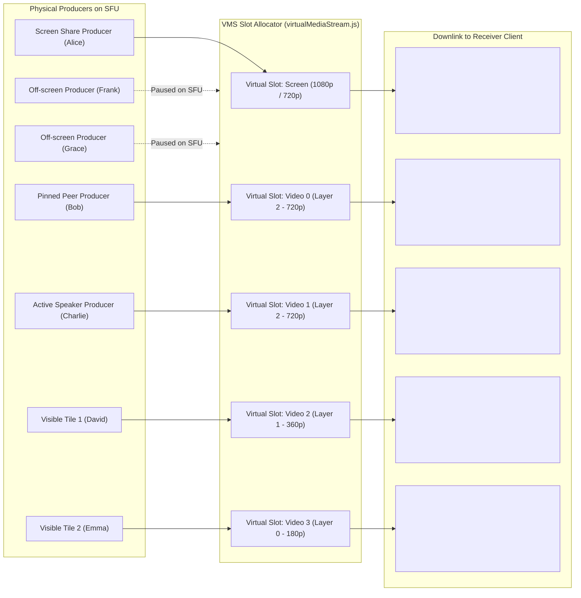

# VORTEX — Virtual Media Streams (VMS) Abstraction

**Document:** `docs/architecture/virtual-media-streams.md`  
**Status:** Architecture Specification & Technical Deep-Dive

---

## 1. The Large-Meeting Downlink Problem

In traditional WebRTC architectures, every remote video track creates an independent downstream `RTCRtpReceiver` and `HTMLVideoElement`. When 50 to 500 participants join a meeting:
- If all 500 cameras are subscribed simultaneously, client downlink bandwidth exceeds **50–150 Mbps**, and CPU usage spikes to 100%, causing browser freezes and audio degradation.
- Mesh topologies require $N \times (N - 1)$ connections, which collapses at $\approx 6$ participants.
- Naive SFUs forward all producers, overwhelming client decoders.

---

## 2. Technical Taxonomy & Architectural Distinctions

To prevent confusion between distinct media engineering concepts, VORTEX establishes clear boundaries:

| Technology | Layer | Mechanism | Server CPU Cost | Client Flexibility |
| :--- | :--- | :--- | :--- | :--- |
| **Logical Virtual Media Stream (VMS)** *(VORTEX)* | Application & Signaling | Allocates a fixed set of logical downstream slots per receiver (e.g. 1 Screen + 6 Video). Dynamically maps highest-priority physical producers into these slots. Off-screen streams are paused on the SFU. | Low (Pure packet routing) | High (Individual DOM tiles, responsive layout) |
| **Combined RTP Stream (MCU Video Mixing)** | Media Plane (Pixel Transcoding) | Decodes all incoming video frames into an RGB canvas, recomposes into a single video frame, and re-encodes a single RTP stream. | Extreme (Server GPU/CPU transcoders required) | Low (Client receives a single locked video feed; cannot reposition tiles) |
| **Standard Mediasoup SFU** | Network Plane | Selective packet forwarding without transcoding or slot abstraction. | Low | High |

---

## 3. The VORTEX Virtual Media Stream Model

### Slot Priority Hierarchy:
1. **Screen Share Slot**: Highest priority; bound as soon as a participant shares their screen.
2. **Pinned Participant Slot**: Bound to any participant explicitly pinned by the user.
3. **Active Speaker Slot**: Bound to the participant currently vocalizing (via VAD).
4. **Recent Speakers Slots**: Retained in high-priority slots for 8 seconds to prevent video flashing/thrashing.
5. **Visible Viewport Slots**: Bound to the paginated grid tiles currently displayed on screen.
6. **Inactive Producers**: Automatically paused on the SFU with `consumer.pause()`, consuming **0 kbps** of downlink bandwidth.

---

## 4. Simulcast Layer Integration

Each occupied Virtual Slot dynamically requests the optimal Mediasoup simulcast layer:
- **Active Speaker & Pinned Slots**: Spatial Layer 2 (720p @ 900 kbps).
- **Visible Grid Slots**: Spatial Layer 1 (360p @ 300 kbps) or Layer 0 (180p @ 100 kbps).
- **Network Degradation**: The `NetworkMonitor` downshifts all active slots to Layer 0 or audio-only under severe packet loss (>15%).

